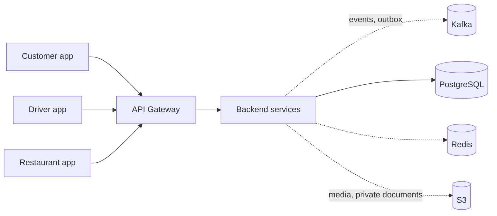

  

<h3 align="center">An open-source food delivery platform: customer, driver and restaurant apps on an event-driven backend</h3>

  
  
  
  
  

---

**Delivery Plus** connects three roles around one order: a **customer** orders from a **restaurant**, the restaurant prepares it, the platform dispatches a **driver**, and everyone follows the same order in real time. Everything is open source (MIT) and built in the open: the roadmap, the milestones and every issue are public.

## The apps

<table>
<tr>
<td align="center" valign="top" width="25%"> <b><a href="https://github.com/Delivery-Plus0/delivery-plus-customer-app">Customer</a></b> restaurants near you · cart · checkout · live tracking</td>
<td align="center" valign="top" width="25%"> <b><a href="https://github.com/Delivery-Plus0/delivery-plus-driver-app">Driver</a></b> apply · go online · pickup → drop-off · wallet</td>
<td align="center" valign="top" width="50%"> <b><a href="https://github.com/Delivery-Plus0/delivery-plus-restaurant-app">Restaurant</a></b> onboarding · kitchen board · menu and availability</td>
</tr>
</table>

Real screens from each app's web build, in English and Arabic: every app README has a screen-by-screen tour.

## Repositories

| Repository | What it is | Stack |
| --- | --- | --- |
| [**delivery-plus**](https://github.com/Delivery-Plus0/delivery-plus) | The backend: 12 services behind one API gateway, the single source of truth for orders, payments, deliveries and tracking. Also the project-wide issue tracker and roadmap. | NestJS · TypeScript · Kafka · PostgreSQL · Redis · S3 |
| [**delivery-plus-customer-app**](https://github.com/Delivery-Plus0/delivery-plus-customer-app) | Customer app: restaurants that deliver to you, cart, checkout, live order tracking on a map | React Native · Expo Router · Android, iOS, web |
| [**delivery-plus-driver-app**](https://github.com/Delivery-Plus0/delivery-plus-driver-app) | Driver app: application with documents, automatic job assignment, pickup to drop-off, earnings | React Native · Expo Router · Android, web |
| [**delivery-plus-restaurant-app**](https://github.com/Delivery-Plus0/delivery-plus-restaurant-app) | Restaurant dashboard: onboarding and approval, kitchen order board, menu and availability | Expo Router (web-first) |
| [**delivery-plus-infra**](https://github.com/Delivery-Plus0/delivery-plus-infra) | Dev environment on AWS: one EC2 host with a static IP, self-hosted Kafka/Postgres/Redis, Jenkins pipelines | Terraform · Ansible · Docker Compose · Jenkins |
| [**delivery-plus-website**](https://github.com/Delivery-Plus0/delivery-plus-website) | The project website | |

## How the pieces fit

Every app talks only to the API gateway, with a JWT whose role decides what it may do. A typical order: the customer checks out → the restaurant prepares it and marks it ready → the backend assigns an available driver automatically → the driver app shows the job and shares its location → the customer follows the driver on a live map until delivery.

## What works today

- **Accounts:** customer, driver, restaurant owner, staff; refresh sessions, sign-out everywhere, suspension, email verification, phone OTP, password recovery.
- **Onboarding with human approval:** driver applications with private documents and licence expiry, and restaurant applications. Only approved restaurants are listed.
- **Service area:** customers see only the restaurants that deliver to their location, nearest first.
- **Orders end to end:** menus with availability, cart, idempotent checkout, kitchen board, automatic dispatch, delivery steps, cancellations and refunds.
- **Live tracking:** server-sent events with a polling fallback; contact between customer, driver and restaurant during an active delivery.
- **Events:** transactional outbox, idempotent Kafka consumers, retries and dead-letter topics.
- **Arabic (RTL) and English** in all three apps; Maestro end-to-end tests against the real backend in CI.
- **Payments are simulated** for now: a real provider comes with Production 6.

## Roadmap

The work runs in public milestones; the [milestones page](https://github.com/Delivery-Plus0/delivery-plus/milestones) is the source of truth.

| Milestone | Focus | Status |
| --- | --- | --- |
| Production 0 · Hotfix | Payment simulator guard, error handling, driver verification | ✅ Done |
| Production 1 · Accounts & sessions | Refresh sessions, suspension, staff, system principal, password recovery | ✅ Done |
| Production 2 · Onboarding & service area | Driver and restaurant applications with approval, delivery radius, contact during delivery | ✅ Done |
| Production 3 · Admin console I | Admin API, audit trail, approval queues, staff accounts | Next |
| Production 4 · Admin console II | Order timeline, live operations, support actions, finance views | |
| Production 5 · Hardening & staging | Staging, deploy and rollback, timeouts, graceful shutdown, metrics, backups | |
| Production 6 · Real money | Payment provider, webhooks and refunds, earnings, payouts | |
| Production 7 · Messaging & mobile | SMS, push notifications, nearest-driver dispatch, store builds | |
| Production 8 · Launch readiness | Load test, runbooks, account deletion, legal pages, pilot go/no-go | |

## Engineering principles

- **One source of truth.** The backend owns every business rule; the apps are clients like any other.
- **Events over coupling.** State changes are published as events in the same transaction as the change (outbox), and consumed idempotently.
- **Security by default.** HMAC-signed internal calls, no admin rights for service accounts, private documents behind short-lived links, no secret defaults in production.
- **Checked before merge.** Lint, unit and integration tests, migration checks on a fresh database, end-to-end UI tests, CodeQL, dependency audit and container scans on every pull request.
- **Honest status.** What is simulated or missing is written down, not hidden.

## Contributing

We'd love your help, whether it's code, tests, docs, translations or design.

1. Pick an issue: [**good first issues**](https://github.com/Delivery-Plus0/delivery-plus/issues?q=is%3Aissue+is%3Aopen+label%3A%22good+first+issue%22) across the project, or [**help wanted**](https://github.com/Delivery-Plus0/delivery-plus/issues?q=is%3Aissue+is%3Aopen+label%3A%22help+wanted%22).
2. Read [CONTRIBUTING.md](https://github.com/Delivery-Plus0/delivery-plus/blob/dev/CONTRIBUTING.md): branch from `dev` → pull request → CI → review → merge.
3. Run it locally: the backend starts with Docker Compose, and each app runs on the web with `npm run web`.

Questions are welcome in [Discussions](https://github.com/Delivery-Plus0/delivery-plus/discussions). Report vulnerabilities through [SECURITY.md](https://github.com/Delivery-Plus0/.github/blob/main/SECURITY.md), not public issues.

<!-- CONTRIBUTORS:START -->
| # | Contributor | Group | Role | Status | Last 30 days | All time | Focus |
|---|---|---|---|---|---|---|---|
| 1 |  [@Yousefa7medmaher](https://github.com/Yousefa7medmaher) | ⭐ Team | 🛠️ Builder | 🟢 Active | ██████████ 265 | 624 | `docs` `infra` `api-gateway` |
| 2 |  [@bernalalexis-try](https://github.com/bernalalexis-try) | 🌍 Community | 🛠️ Builder | 🟡 Recent | ░░░░░░░░░░ 5 | 10 | `docs` `infra` `notification` |
| 3 |  [@MohamedAhmed-SUT](https://github.com/MohamedAhmed-SUT) | 🌍 Community | 🛠️ Builder | 🟢 Active | ░░░░░░░░░░ 5 | 5 | `docs` `infra` `api-gateway` |
| 4 |  [@Bronyxx](https://github.com/Bronyxx) | 🌍 Community | 🛠️ Builder | 🟡 Recent | ░░░░░░░░░░ 5 | 5 | `docs` `infra` `api-gateway` |
| 5 |  [@arielshakaramiro](https://github.com/arielshakaramiro) | 🌍 Community | 🧭 Planner | 🟢 Active | ░░░░░░░░░░ 1 | 1 | – |

Updated 2026-11-10. Points: 5 per merged pull request, 2 per review of someone else's pull request, 1 per issue opened. Ranked by the last 30 days, then all time. 🟢 active in the last 14 days · 🟡 in the last 60 · ⚪ earlier. Bots are excluded.
<!-- CONTRIBUTORS:END -->
