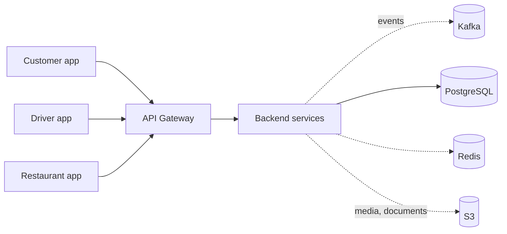

<p align="center">
  
</p>

<h3 align="center">A cloud-native, event-driven platform for on-demand delivery</h3>

<p align="center">
  <b>Customer</b> · <b>Driver</b> · <b>Restaurant</b> · <b>Backend</b>
</p>

---

**Delivery Plus** connects three roles around one order: a **customer** orders from a **restaurant**, the restaurant prepares it, the platform dispatches a **driver**, and everyone follows the same order and delivery state in real time.

The backend is open source (MIT) and built in the open: the roadmap, the milestones and every issue are public.

## Repositories

```text
Delivery Plus
│
├── delivery-plus                  Backend platform: 12 NestJS services behind one API Gateway,
│                                  Kafka events, PostgreSQL, Redis, S3 · issue tracker + roadmap
│
├── delivery-plus-customer-app     Customer app (Expo / React Native: Android, iOS, web)
│                                  browse · cart · checkout · order status · live tracking · alerts
│
├── delivery-plus-driver-app       Driver app (Expo / React Native)
│                                  online/offline · automatic job assignment · pickup → delivered
│
├── delivery-plus-restaurant-app   Restaurant app (Expo / React Native, web-first)
│                                  incoming orders · kitchen workflow · availability
│
└── .github                        This organization profile and the project map
```

| Repository | What it owns | |
|---|---|---|
| [**delivery-plus**](https://github.com/Delivery-Plus0/delivery-plus) | Business rules, data, events, auth and the public API: the single source of truth for orders, payments, deliveries and tracking. Also the project-wide issue tracker and milestones. | Public · MIT |
| **delivery-plus-customer-app** | The customer experience | Private |
| **delivery-plus-driver-app** | The driver experience | Private |
| **delivery-plus-restaurant-app** | The restaurant experience | Private |
| [**.github**](https://github.com/Delivery-Plus0/.github) | Organization profile and project map | Public |

## How the pieces fit



Every app talks only to the API Gateway, with a JWT whose role decides what it may do; the apps never call each other. A typical order: the customer checks out → the restaurant starts preparing and marks it ready → the backend automatically assigns an online driver → the driver app shows the job and shares its location → the customer app shows the driver and the live map until delivery.

## Status

The platform works end to end on a simulated payment provider. The current effort is turning it into something that can run a real pilot: accounts that are safe to operate, onboarding with human approval, an admin console, a staging environment, real money and real messaging.

**Implemented**

- Accounts and roles (customer, driver, restaurant owner, admin, staff) with JWT access tokens and rotating refresh sessions; logout from one or all devices; account suspension; per-staff permissions; email verification and phone OTP; password change and recovery by SMS code (closing out the first production milestone)
- Restaurants, menus with availability, Redis cart, and the order lifecycle with idempotent creation
- **Simulated** payments (no real card provider yet)
- Automatic driver dispatch, driver verification gate, and the delivery lifecycle (assigned → picked up → in transit → delivered)
- Live tracking with server-sent events and a polling fallback, plus a customer-safe driver card
- In-app notifications for each order stage
- Order and delivery events through a transactional outbox, Kafka consumers with deduplication, retries and dead-letter topics
- Direct-to-S3 media uploads with presigned POST
- The three apps' core flows, including history, ratings, menu management, profiles, Egypt locale and Arabic/RTL

**Roadmap: from prototype to production**

The work is organised in public milestones. Target dates will move as we learn; the [milestones page](https://github.com/Delivery-Plus0/delivery-plus/milestones) is the source of truth.

| Milestone | Focus | Target |
|---|---|---|
| **Production 0 · Hotfix** | Close the critical gaps found in review: payment simulator guard, error handling, driver verification | Done |
| **Production 1 · Accounts & sessions** | Refresh sessions, suspension, staff identities, a separate system principal, password recovery | Nov 2026 |
| **Production 2 · Onboarding & service area** | Driver applications with private documents, restaurant applications and approval, delivery radius, fairer dispatch | Nov 2026 |
| **Production 3 · Admin console I** | Admin API foundation, audit trail, approvals, staff accounts | Nov 2026 |
| **Production 4 · Admin console II** | Order timeline, live operations, support actions, finance views | Dec 2026 |
| **Production 5 · Platform hardening & staging** | Staging environment, deploy and rollback, timeouts, graceful shutdown, health checks, metrics, backups | Dec 2026 |
| **Production 6 · Real money** | Real payment provider, webhooks and refunds, earnings ledger, driver payouts | Jan 2027 |
| **Production 7 · Messaging & mobile** | Real SMS provider, push notifications, nearest-driver dispatch, notification templates | Jan 2027 |
| **Production 8 · Launch readiness** | Load test, runbooks, account deletion and data export, production bootstrap, pilot go/no-go | Feb 2027 |
| **Production 9 · After launch** | Operating hours, event contract registry, shared package hardening | Mar 2027 |

Password recovery by SMS works in the code but stays unavailable in production until a real SMS provider is connected (Production 7).

See the [backend README](https://github.com/Delivery-Plus0/delivery-plus#readme) for the architecture and per-service detail.

## Engineering principles

- **One source of truth.** The backend owns every business rule; the apps are clients like any other.
- **Events over coupling.** State changes are published as events, written in the same transaction as the change (outbox), and consumed idempotently.
- **Security by default.** Services call each other with HMAC-signed internal requests; service accounts never carry admin rights; personal documents live in private storage behind short-lived links; secrets have no defaults in production.
- **Checked before merge.** Every pull request runs lint, tests, builds, migration verification on a fresh database, CodeQL, dependency audit, and container and filesystem scans.
- **Honest status.** What is simulated or missing is written down, not hidden.

## Contributing

Work happens on feature branches → pull request → CI → review → merge into `dev`. Start with the backend's [CONTRIBUTING.md](https://github.com/Delivery-Plus0/delivery-plus/blob/dev/CONTRIBUTING.md).

<!-- CONTRIBUTORS:START -->
| # | Contributor | Group | Role | Status | Last 30 days | All time | Focus |
|---|---|---|---|---|---|---|---|
| 1 | <a href="https://github.com/Yousefa7medmaher"></a> [@Yousefa7medmaher](https://github.com/Yousefa7medmaher) | ⭐ Team | 🛠️ Builder | 🟢 Active | ██████████ 388 | 541 | `docs` `infra` `api-gateway` |
| 2 | <a href="https://github.com/bernalalexis-try"></a> [@bernalalexis-try](https://github.com/bernalalexis-try) | 🌍 Community | 🛠️ Builder | 🟡 Recent | ░░░░░░░░░░ 5 | 10 | `docs` `infra` `notification` |
| 3 | <a href="https://github.com/MohamedAhmed-SUT"></a> [@MohamedAhmed-SUT](https://github.com/MohamedAhmed-SUT) | 🌍 Community | 🛠️ Builder | 🟢 Active | ░░░░░░░░░░ 5 | 5 | `docs` `infra` `api-gateway` |
| 4 | <a href="https://github.com/Bronyxx"></a> [@Bronyxx](https://github.com/Bronyxx) | 🌍 Community | 🛠️ Builder | 🟢 Active | ░░░░░░░░░░ 5 | 5 | `docs` `infra` `api-gateway` |

<sub>Updated 2026-10-31. Points: 5 per merged pull request, 2 per review of someone else's pull request, 1 per issue opened. Ranked by the last 30 days, then all time. 🟢 active in the last 14 days · 🟡 in the last 60 · ⚪ earlier. Bots are excluded.</sub>
<!-- CONTRIBUTORS:END -->

- Looking for a place to start? Browse the issues labelled [**help wanted**](https://github.com/Delivery-Plus0/delivery-plus/issues?q=label%3A%22help+wanted%22+is%3Aissue+is%3Aopen).
- Issues that handle personal data or security are labelled `security`: please post a short design in the issue and agree on it before writing code.
- Report vulnerabilities through [SECURITY.md](https://github.com/Delivery-Plus0/delivery-plus/blob/dev/SECURITY.md), not public issues.
