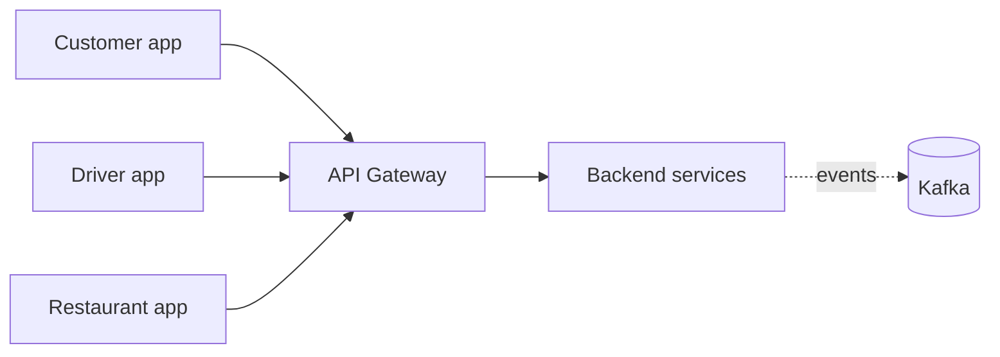

<p align="center">
  
</p>

<h3 align="center">A cloud-native, event-driven platform for on-demand delivery</h3>

<p align="center">
  <b>Customer</b> · <b>Driver</b> · <b>Restaurant</b> · <b>Backend</b>
</p>

---

**Delivery Plus** connects three roles around one order: a **customer** orders from a **restaurant**, the restaurant prepares it, the platform dispatches a **driver**, and everyone follows the same order and delivery state in real time.

## Repositories

```text
Delivery Plus
│
├── delivery-plus                  Backend platform: 12 NestJS services behind one API Gateway,
│                                  Kafka events, PostgreSQL, Redis, S3 · issue tracker + roadmap
│
├── delivery-plus-customer-app     Customer app (Expo / React Native: Android, iOS, web)
│                                  browse · cart · checkout · order status · live tracking · alerts
│
├── delivery-plus-driver-app       Driver app (Expo / React Native)
│                                  online/offline · automatic job assignment · pickup → delivered
│
└── delivery-plus-restaurant-app   Restaurant app (Expo / React Native, web-first)
                                   incoming orders · kitchen workflow · availability
```

| Repository | What it owns | |
|---|---|---|
| [**delivery-plus**](https://github.com/Delivery-Plus0/delivery-plus) | Business rules, data, events, auth and the public API: the single source of truth for orders, payments, deliveries and tracking. Also the project-wide issue tracker and milestones. | Public · MIT |
| **delivery-plus-customer-app** | The customer experience | Private |
| **delivery-plus-driver-app** | The driver experience | Private |
| **delivery-plus-restaurant-app** | The restaurant experience | Private |

## How the pieces fit



Every app talks only to the API Gateway, with a JWT whose role decides what it may do; the apps never call each other. A typical order: the customer checks out → the restaurant starts preparing and marks it ready → the backend automatically assigns an online driver → the driver app shows the job and shares its location → the customer app shows the driver and the live map until delivery.

## Status

- **Implemented:** accounts and roles, restaurants and menus, cart, orders, **simulated** payments, automatic dispatch, the delivery lifecycle, live tracking (server-sent events), in-app notifications, and the three apps' core flows.
- **In progress:** [Product sprint · Business & UX](https://github.com/Delivery-Plus0/delivery-plus/milestone/10): history, ratings, menu management UI, profiles, Egypt locale, Arabic/RTL, OTP.
- **Planned:** real payment provider, push notifications, ETA estimation, driver earnings and wallet, production deployment.

See the [backend README](https://github.com/Delivery-Plus0/delivery-plus#readme) for the architecture and the full status.

## Contributing

Work happens on feature branches → pull request → CI → review → merge into `dev`. Start with the backend's [CONTRIBUTING.md](https://github.com/Delivery-Plus0/delivery-plus/blob/dev/CONTRIBUTING.md); report security issues through its [SECURITY.md](https://github.com/Delivery-Plus0/delivery-plus/blob/dev/SECURITY.md), not public issues.
